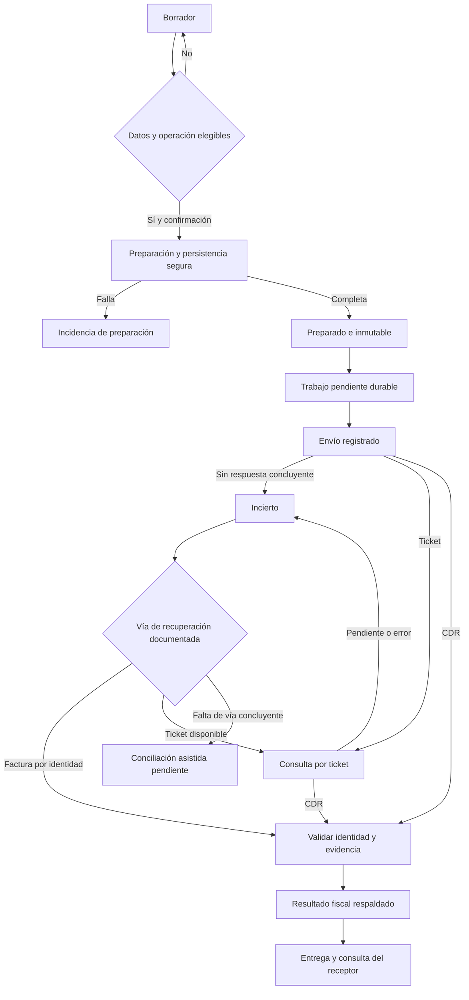

# Flujos esenciales — H0, versión 0.3

**24/10/2026 · Conceptual, pendiente de aprobación.** Derivado del Plan Maestro §§4–6, [PRD](01_PRD.md) y [matriz fiscal](MATRIZ_FISCAL.md). Los nombres de estado son lenguaje de planificación, todavía no enums, tablas ni contratos externos.

## Tres dimensiones distintas

| Dimensión | Estados conceptuales | Evidencia para cambiar |
|---|---|---|
| Documento | BORRADOR → PREPARADO | Identidad fiscal, contenido y artefactos íntegros persistidos. |
| Transporte de cada envío/comunicación | PENDIENTE → ENVIANDO → RESPUESTA_CONFIRMADA / INCIERTO / ERROR_RECUPERABLE | Intento registrado, respuesta y correlación. En asíncrono, ticket conservado mientras se consulta resultado. |
| Resultado fiscal de documento o comunicación | SIN_CONFIRMAR → ACEPTADO / ACEPTADO_CON_OBSERVACIONES / RECHAZADO, cuando corresponda al tipo | CDR/evidencia aplicable examinada y vinculada al objeto correcto. Las observaciones acompañan una aceptación cuando la evidencia lo sustenta. |

El estado de otorgamiento, la baja y la entrega al receptor son hechos adicionales: no se deducen de que un envío HTTP haya terminado. Una CDR de resumen se vincula con sus miembros; no se inventa una CDR individual por cada boleta.

El arco «Factura por identidad» representa una consulta que puede recuperar la CDR; no garantiza que toda consulta produzca un resultado. Sin evidencia concluyente el documento sigue incierto. La conciliación sin ticket es AF-04 y no está resuelta por este diagrama.

## Flujo de configuración

La [adenda operativa confirmada](../DOCS_GREENTER/ADENDA_H0_MODELO_OPERATIVO.md) establece una instalación independiente por cliente, administrada técnicamente por el proveedor, con un RUC inicial. El proveedor administra infraestructura, controles, custodia técnica, soporte y operación del software; cliente/representante confirma datos, autorizaciones y operaciones y decide actuaciones tributarias con su profesional competente. H1 seguirá limitado a datos/credenciales ficticios cuando sea autorizado.

Responsable identifica empresa, canal fiscal efectivo, series y certificado/credenciales según el modelo aprobado. El sistema verifica permisos y muestra faltantes sin revelar secretos. Activar producción fiscal exige elegibilidad confirmada y consentimiento específico; desplegar la aplicación en producción no cambia automáticamente el ambiente SUNAT.

La edición de configuración afecta nuevas operaciones. Documentos previos conservan sus datos, archivos, huellas y contexto. Si otra aplicación usa una serie, debe acordarse asignación exclusiva o coordinación demostrable antes de emitir.

## Factura y notas vinculadas a factura

1. Operador autorizado crea borrador del alcance; datos y cálculos sujetos a MF-03–04 y MF-13–17.
2. Confirma emisor, receptor, ambiente, totales y operación. La confirmación recibe una identidad de operación que permite resolver repeticiones.
3. Preparación asigna identidad de manera consistente, genera/firma y guarda los artefactos. Solo se considera PREPARADO cuando el conjunto requerido puede recuperarse de forma segura. No existe una transacción automática entre PostgreSQL y archivos: H2 deberá resolver fallos intermedios y limpieza controlada.
4. Se registra trabajo durable y el intento de envío. Fallo de base/archivos bloquea nuevas emisiones que no puedan persistirse.
5. Una respuesta concluyente conserva la CDR y comprueba identidad y resultado. Faults técnicos o de negocio se clasifican; no son todos rechazo fiscal del documento.
6. Ante timeout o caída después del envío, se mantiene INCIERTO. Se consulta por identidad según MF-09; hasta obtener evidencia suficiente no se regenera ni se cambia el comprobante.
7. Se entrega y habilita consulta al receptor según el procedimiento aprobado. Propuesta operativa: esperar aceptación para entrega definitiva de factura, sin alterar la obligación aplicable ni prometer aceptación inmediata.

Una operación repetida con iguales datos devuelve su resultado existente. Con la misma identidad de operación y datos distintos, informa conflicto. Un rechazo confirmado conduce a evaluación de corrección tributaria y nueva operación cuando proceda; no a edición silenciosa del XML original.

## Boleta y resumen — propuesta D-07

La boleta mantiene identidad y otorgamiento propios. Su información se agrupa por fecha de emisión en una comunicación inmutable, con relación explícita a cada documento y versión de información comunicada. No se espera al vencimiento legal para empezar el procesamiento.

El resumen se envía, conserva el ticket y consulta su resultado hasta obtener CDR o una incidencia que requiera actuación. El ticket prueba recepción para procesamiento; no prueba aceptación. La pantalla muestra «pendiente de informar», «en proceso» o situación respaldada por la CDR, sin atribuir a SUNAT estados que no envía.

Si se rechaza un resumen se conserva ese envío y se prepara la corrección procedente conforme MF-06; no se modifica el resumen ya transmitido. Reenvío de transporte del mismo paquete y sustitución/rectificación de información son operaciones distintas. El procedimiento fiscal, los códigos de estado y las versiones admitidas quedan pendientes de la revisión de reglas.

### Política conservadora ante respuesta incierta o ticket no recibido

1. Conservar identidad original, XML/ZIP firmado y sus huellas, ambiente, empresa, documentos miembros, fecha de referencia/generación, intento, timestamps y respuesta/error saneados. No incluir secretos en el expediente. Registrar **INCIERTO / SIN_CONFIRMAR**; no registrar rechazo o aceptación por timeout.
2. Suspender reenvío automático y creación de otro RC/RA para los mismos documentos afectados. Mantener el incidente visible y asignado. Otros documentos o instalaciones independientes pueden continuar si sus garantías y plazos se mantienen; no extender el bloqueo fuera de los recursos afectados.
3. Si se tiene ticket válido, consultar el procedimiento oficial con límites y escalamiento acordes al plazo. Un ticket ajeno/inexistente o un error temporal exige diagnóstico; no prueba que la comunicación original no fuera recibida. Para factura/notas elegibles, usar la consulta por identidad de MF-09, sin extenderla por analogía a RC/RA.
4. Sin ticket, el responsable de soporte prepara el expediente y el representante autorizado coordina la revisión mediante los mecanismos oficiales disponibles para su modalidad o el PSE contratado, si lo hubiera. Se registran referencia de atención, resultado y evidencia obtenida. **No se ha confirmado una función oficial que permita recuperar ticket/CDR de RC/RA solo por su identificador**; este paso es escalamiento, no una recuperación garantizada. No se realiza ninguna gestión externa en H0.
5. Cualquier indicación de «ya presentado» o duplicado se trata como indicio de recepción previa, nunca como aceptación. Los códigos concretos inspeccionados y sus celdas están en F23 de la matriz. No cambiar correlativo, fecha, XML ni contenido para sortear el error.
6. Cerrar incertidumbre solo con evidencia oficial suficiente vinculada a empresa, ambiente y comunicación/documentos correctos, revisada por autorizado. Si se requiere otra comunicación, rectificación o reintento, justificar procedimiento e identidad con validación fiscal/técnica; no ejecutarlo automáticamente porque haya pasado un tiempo.
7. Escalar antes del vencimiento al responsable operativo y revisor fiscal. Si no se obtiene evidencia concluyente, el estado permanece incierto y se registra la actuación pendiente. No prorrogar el plazo legal, asumir silencio positivo ni considerar resuelto el incidente por aceptación del riesgo.

La política de contención queda documentada; **AF-04 sigue abierto sobre la vía efectiva de recuperación sin ticket**. La adenda, cuya incorporación confirmó el propietario, permite mantenerlo como pendiente con responsable y puerta antes de habilitar el flujo real afectado; no bloquea por sí solo una POC H1 ficticia. Esto ajusta el criterio anterior de cierre H0 y no declara recuperable toda V1 ni autoriza H1. Antes de liberar boletas/bajas se debe validar un procedimiento efectivo —incluida la vía asistida si corresponde— y probar la contención; sin esa evidencia el flujo real permanece bloqueado.

## Alta, restauración y retirada de una instalación

El proveedor prepara cada instalación separada y registra responsables/accesos autorizados; el cliente acredita su identidad/modalidad fiscal antes de activarla realmente. El alta y los controles locales acompañan H2; despliegue/restauración/salida se verifican en H7. La restauración utiliza respaldo cifrado separado del VPS, comprueba base, archivos y materiales de recuperación y concilia intentos antes de reactivar envíos. Ninguno de estos procedimientos se ejecuta durante H0.

Al terminar el servicio, el proveedor prepara exportación de datos y archivos con integridad verificable, el cliente designa receptor y confirma recepción y se revocan los accesos según el acuerdo. Se documentan custodia y conservación residual aplicables; la retirada del VPS no debe eliminar evidencia exigible ni provocar reenvíos. Titularidad, pago, soporte/contactos, retención, salida y objetivos de recuperación deben quedar aceptados antes de H8.

## Notas y bajas

| Solicitud del usuario | Verificación previa | Resultado esperado |
|---|---|---|
| Modificar operación ya otorgada | Motivo NC/ND aprobado, referencia, mismo receptor, importes y condición previa elegibles | Nuevo documento relacionado; el original permanece íntegro. |
| Dar de baja numeración no otorgada de factura/nota vinculada | Condiciones y fechas MF-11 | Comunicación de baja, ticket, consulta y evidencia; no borrar original. |
| Dar de baja boleta/nota vinculada no otorgada | MF-12: informado/no informado y fecha de referencia aplicable | Resumen con información de baja y evidencia propia. |
| Corregir receptor/descripción mediante excepción | AF-01 pendiente o fuera de alcance aprobado | No ofrecer acción automática hasta resolución o exclusión expresa. |
| Operación no soportada o vencida | Matriz y alcance | Explicación y atención fiscal competente; no inventar subsanación. |

La vista de correcciones pregunta por la intención y muestra el procedimiento elegible. No incluye un botón genérico que cambie cualquier documento a «anulado». La aceptación de una baja no reescribe la CDR original.

## Recuperación y errores esenciales

| Evento | Comportamiento exigido |
|---|---|
| Dos confirmaciones de la misma operación | Una emisión lógica; recupera estado existente. |
| Dos operadores de una serie | Correlativos únicos; resultado persistente sin corrupción. |
| Falla al guardar archivo o confirmar transacción | No comunicar preparación exitosa; conservar trazabilidad de reserva/fallo según diseño aprobado. |
| Worker muere después del envío | Recuperar intento y conciliar antes de repetir; lease/bloqueo local no garantiza procesamiento único remoto. |
| Redis falla, si se incorpora | Pendientes permanecen en PostgreSQL; degradación visible. |
| Certificado/credencial inválidos | Detener operaciones afectadas, diagnóstico saneado y actualización por autorizado. |
| Vence plazo / consulta sigue pendiente | Incidencia asignada y escalamiento según matriz; no aceptación por tiempo transcurrido. |
| Receptor/usuario solicita archivo ajeno | Denegar en servidor, sin exponer el archivo ni su contenido. |
| Se restaura respaldo | Conciliar documentos, archivos e intentos frente al estado SUNAT antes de reanudar envíos. |

No se fija cantidad de reintentos ni frecuencia de consulta sin datos de servicio/plazo. Se definirán límites, retroceso y escalamiento con la ruta aprobada. No se promete entrega «exactamente una vez» de una red distribuida; se exige idempotencia local y reconciliación demostrable.
