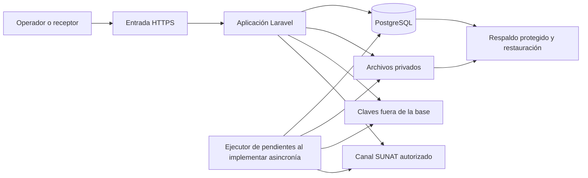

# TRD y arquitectura — H0, versión 0.3

**24/10/2026 · Propuesta conceptual.** Fuente: Plan Maestro §§1, 3–4 y H1–H7; AGENTS reglas 1, 4, 6 y 9. Decisiones: [control H0](00_H0_REVISION_Y_APROBACIONES.md). No se seleccionaron versiones ni se verificó compatibilidad ejecutando software.

## Dirección recomendada

Monolito Laravel con PostgreSQL y un adaptador pequeño para Greenter, conforme D-04. Permite mantener en un mismo límite transaccional identidad, numeración, documento y trabajo pendiente, y reduce coordinación operativa. Las responsabilidades se separan donde faciliten comprensión y pruebas, sin imponer paquetes o capas vacías.

La [adenda operativa confirmada por el propietario](../DOCS_GREENTER/ADENDA_H0_MODELO_OPERATIVO.md) establece **un VPS y un Docker Compose por cliente**, con servicio web, PostgreSQL y volumen persistente; ejecutor solo al necesitarse. El proveedor administra técnicamente cada instalación, inicialmente para un RUC. No se fija proveedor VPS, capacidad, precio ni servicio adicional. Vue + Inertia sigue como candidato a ratificar o aplazar justificadamente en H1. No hay autorización para instalar dependencias, scaffolding, contenedores o CI.

## Fronteras de responsabilidad

| Responsabilidad | Posee / hace | No debe decidir |
|---|---|---|
| Identidad y acceso | Usuarios, pertenencia y permisos del servidor | Elegibilidad tributaria por presencia de un usuario. |
| Empresa y configuración fiscal | RUC/configuración, series, referencias a secretos y ambiente efectivo | Alterar documentos históricos al actualizar parámetros. |
| Emisión | Datos fiscales, cálculos aprobados, identidad, invariantes y relaciones | Inferir aceptación por éxito de red. |
| Transporte SUNAT | Operaciones de envío/consulta y respuestas normalizadas con evidencia | Cambiar correlativos o XML para ocultar un error de transmisión. |
| Evidencias y archivos | Objetos privados, integridad, vínculo documental y recuperación | Publicar rutas o claves de almacenamiento como autorización. |
| Seguimiento y auditoría | Intentos, incertidumbre, incidencias y acciones relevantes | Duplicar todo dato sensible en logs o convertirse en un sistema de eventos general. |

Greenter realiza las funciones de biblioteca que se demuestren compatibles en H1. La aplicación conserva sus reglas de negocio y estados; no se replica manualmente toda la especificación UBL/SOAP ni se trata el SDK como fuente normativa.

## Despliegue mínimo propuesto

El esquema corresponde a **una instalación** y se repite de forma independiente por cliente; no es una plataforma compartida. Aplicación y ejecutor pueden ser procesos del mismo artefacto. El respaldo se cifra y se mantiene separado del VPS, con base, archivos y materiales de recuperación de claves coherentes; la clave para descifrarlo requiere custodia separada. No se obliga a un KMS externo ni a un proveedor cloud. Un snapshot sin restauración verificada no acredita recuperación.

## Persistencia, concurrencia y trabajo pendiente

Se propone una outbox transaccional en PostgreSQL para registrar trabajo pendiente junto con la emisión. Redis no es fuente única de verdad. El ejecutor se incorpora cuando exista trabajo asíncrono que procesar; incorporar Redis requiere utilidad demostrada y decisión, no anticipación.

La garantía de integridad requiere restricción única, transacción, control de concurrencia e idempotencia de la operación. La combinación de base y archivos no se vuelve atómica por usar una outbox: H2 debe especificar preparación temporal, publicación de artefactos, fallos intermedios y recuperación sin reutilización accidental de identidad. Es requisito de diseño pendiente, no algoritmo ya aprobado.

SUNAT puede haber procesado una solicitud aunque el proceso local caiga. Deben distinguirse el trabajo local, cada intento y la evidencia remota. No se usará el mecanismo de colas para justificar reintentos ciegos ni prometer procesamiento remoto único.

## Aislamiento por instalación y administración técnica

D-01 queda aprobada como distribución independiente administrada: un RUC inicial, usuarios/roles, PostgreSQL, documentos, configuración, secretos y respaldos separados por cliente. No crear subsistema global de tenants, consola central, particiones/RLS de una BD compartida ni selector de empresas para este modelo. Se mantienen autorización del servidor y acceso reservado del receptor dentro de cada instalación.

El proveedor administra infraestructura que puede contener secretos: **es custodio técnico y tiene capacidad de acceso privilegiado**, no se declara custodia exclusiva del cliente. Acceso no rutinario, autorizado, mínimo y auditado; cifrado autenticado mediante herramientas mantenidas, claves separadas de BD/archivos, rotación/revocación bajo autorización y recuperación controlada. No crear criptografía propia. La adenda §2 conserva el reparto completo: proveedor opera software e infraestructura; cliente confirma operaciones y asume las decisiones tributarias con su profesional competente.

Instalaciones separadas tampoco autorizan numerar un mismo RUC de forma independiente en sistemas concurrentes. SEE del contribuyente y certificado/credenciales del cliente permanecen condicionados a elegibilidad y dictamen PSE (MF-02). La POC H1 será ficticia; la validación regulatoria es obligatoria antes de prestar actividades reales y antes de comprometer una integración incompatible con ella.

## Seguridad y operación requeridas por el Plan

- Identidad/permisos/propiedad en servidor; sesiones seguras, CSRF cuando corresponda, límites de intentos y controles de descargas.
- Custodia de certificados, credenciales y claves con cifrado autenticado, permisos mínimos y separación de claves respecto de datos cifrados. Sin algoritmos ni proveedores seleccionados en H0.
- Cargas de certificado y respuestas XML/ZIP restringidas por tipo y tamaño; manejo seguro de XML y archivos comprimidos. No procesar contenido remoto como instrucciones.
- Evidencia original conservada y protegida de modificación ordinaria; huellas para detectar alteraciones y acceso auditado. No se exige blockchain, event sourcing ni un servicio de inmutabilidad especializado.
- HTTPS, firewall/puertos mínimos, cuentas técnicas de privilegio mínimo, SSH restringido y autenticación fuerte de administración; depuración pública desactivada y ambientes separados.
- Alertas mínimas por instalación: disponibilidad/espacio, vencimiento de certificado, backup fallido, pendientes bloqueados, plazos fiscales próximos y errores SUNAT. Sin plataforma central obligatoria ni payloads sensibles en logs.
- Respaldo cifrado separado del VPS y restauración probada de base/archivos/configuración/material de recuperación; conciliar trabajo pendiente antes de reactivar envíos.
- Despliegues con copia previa, migraciones controladas y reversión que conserve evidencia; baja del servicio con exportación y revocación de accesos conforme acuerdo y conservación aplicable.

Los controles son requisitos del Plan/AGENTS y la adenda, no una seguridad ya demostrada. Antes de H8 se aceptarán titularidad y pago del VPS, datos, autorizaciones, soporte/contactos, retención, respaldo/restauración, salida y RPO/RTO realistas y probados. Proveedor, precio, capacidad y ventanas operativas siguen pendientes; no se promete SLA no demostrado.

## Prueba técnica posterior H1, solo tras autorización explícita

Se verificará versión mantenida/parcheada de PHP/Laravel y compatibilidad con Greenter, extensiones, PostgreSQL, licencia y dependencias transitivas. La evidencia deberá registrar versiones efectivas y lockfiles, una instalación reproducible y XML/firma verificables con datos ficticios. No se afirma compatibilidad por el simple nombre del stack recomendado.

La prueba debe aclarar generación y firma de factura y capacidad de las comunicaciones previstas, sin construirlas todas. Beta y recuperación en producción tienen alcances distintos; falta de acceso a una consulta de producción no se ocultará tras mocks.

## Límites contra sobreingeniería

No microservicios, Kubernetes, bus de eventos, arquitectura genérica de proveedores fiscales, API pública, motor de flujos, RBAC configurable, KMS/HSM obligatorio, facturación SaaS ni motores multiimpuesto universales sin necesidad aprobada. Se conserva lo indispensable para integridad, seguridad, recuperación y obligaciones del alcance. Extraer un servicio se reconsiderará con una necesidad medida, no por número de líneas.
